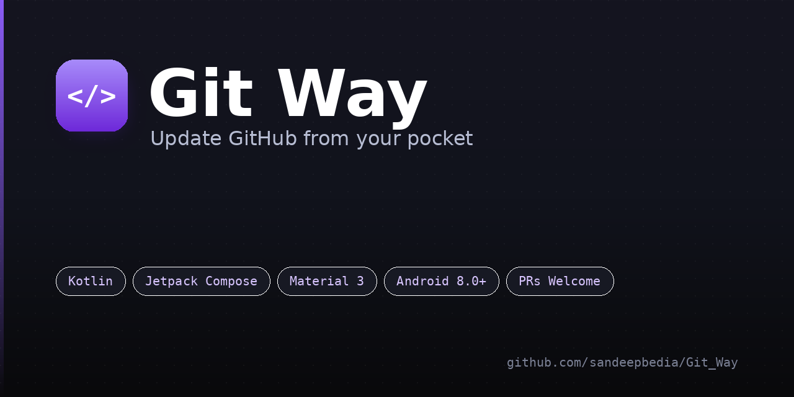
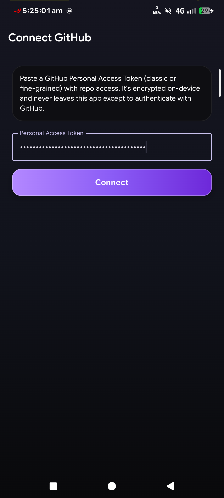
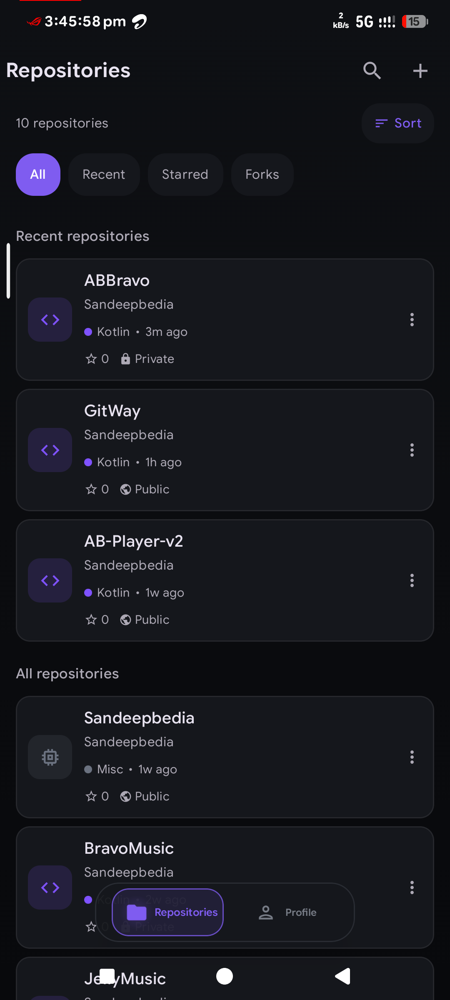
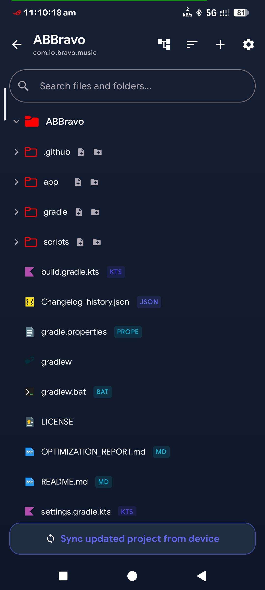
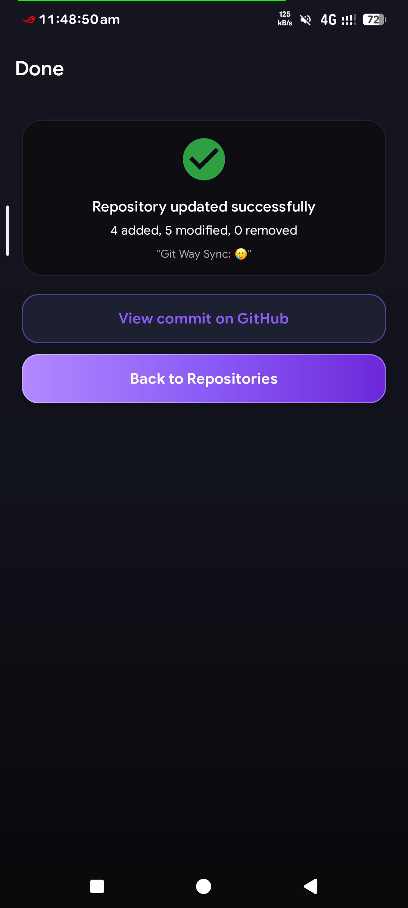
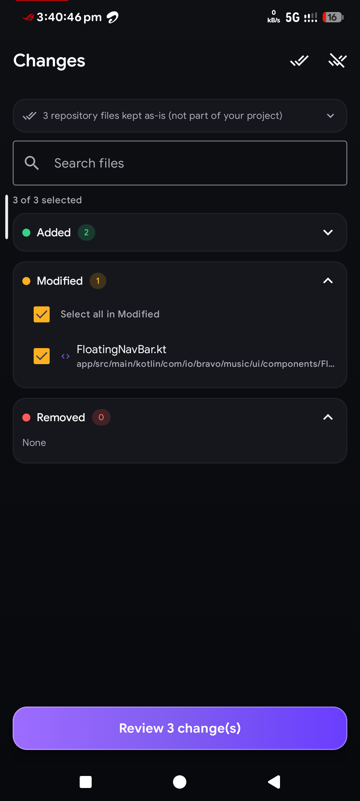
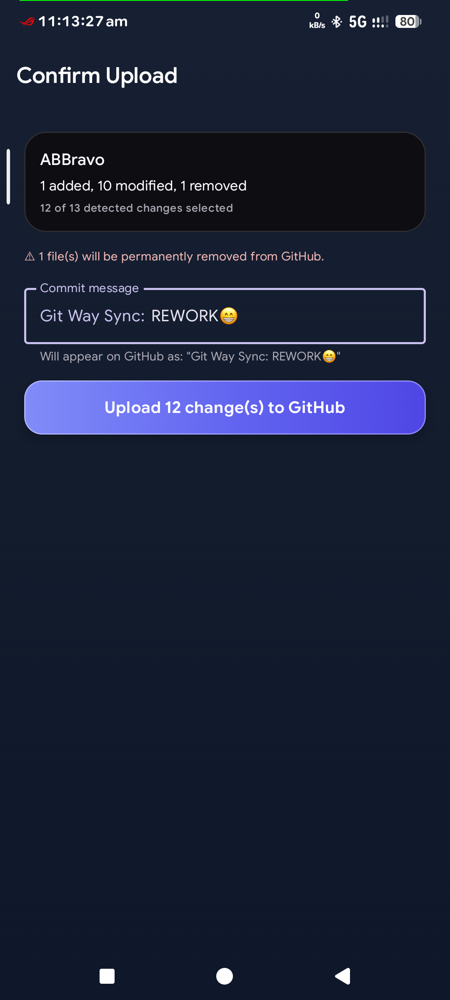
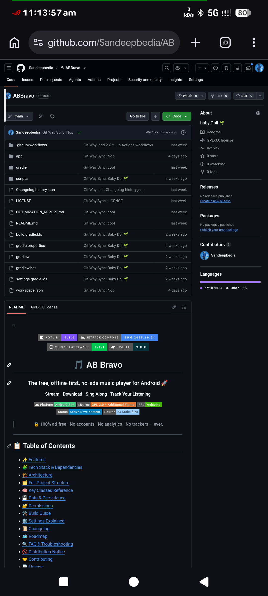
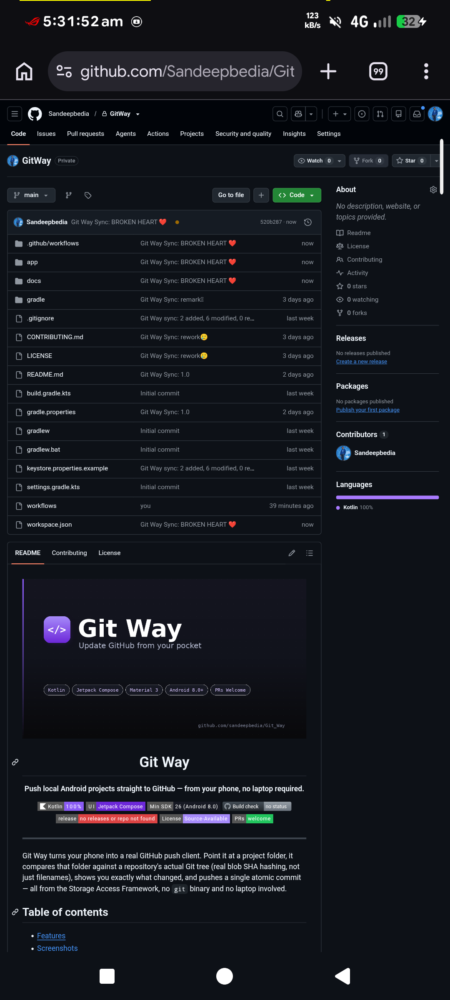
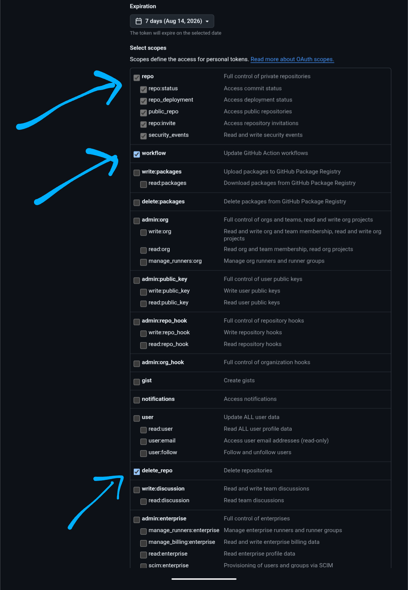

<div align="center">



# Git Way

**Your GitHub, from your phone — push projects and manage repos, PRs, issues and releases, no laptop required.**

[](https://kotlinlang.org)
[](https://developer.android.com/jetpack/compose)
[-171923?style=flat-square)](#)
[](https://github.com/Sandeepbedia/GitWay/actions/workflows/build-check.yml)
[](https://github.com/Sandeepbedia/GitWay/releases/latest)
[](LICENSE)
[](CONTRIBUTING.md)

</div>

---

Git Way is a real GitHub client that runs entirely on Android. It started as a
way to push a local Android project to GitHub straight from the Storage Access
Framework — no `git` binary, no laptop — and grew into a full client: repositories,
file browser, Actions, pull requests, issues, releases and code search.

Everything talks to `api.github.com` directly using a Personal Access Token you
paste in at runtime. No backend, no proxy, no third-party server.

## Table of contents

- [Features](#features)
- [Screens](#screens)
- [Screenshots](#screenshots)
- [Tech stack](#tech-stack)
- [Project structure](#project-structure)
- [How a push actually works](#how-a-push-actually-works)
- [Getting started](#getting-started)
- [Contributing](#contributing)
- [License](#license)

## Features

**Push & compare**
- Real diff engine — local files are hashed exactly the way Git hashes a blob and
  compared against the repository's live tree, so Added / Modified / Removed is
  accurate, never guessed from timestamps.
- Atomic commits via the Git Data API (blob → tree → commit → ref update) — a push
  either lands completely or not at all.
- Retry with backoff on transient failures only (timeouts, 500/502/503/504).
  Permissions and validation errors are never retried — GitHub's real message is
  parsed and shown instead of a bare `HTTP 422`.
- Live progress through every stage: Validating → Uploading files → Creating tree →
  Creating commit → Updating branch → Verifying → Done, cancellable at each step.
- Push to any branch, or create a new one from an existing branch.
- Commit history and per-file commit diffs are viewable in-app.

**Safety**
- **Smart Upload Protection** — scans every file before upload for secrets (API
  keys, tokens) and sensitive files (keystores, `.env`), blocking or redacting them.
- **Project/Repository Identity Match** — reads the Android `applicationId` from both
  the local folder and the remote repo, and warns on mismatch, so one app's code
  can't land in another app's repo.
- **Scaffold-safe deletes** — repository-owned files (`README.md`, `LICENSE`,
  `.github/`, `.gitignore`, `.gitkeep`, `screenshots/`, `docs/`, …) are never
  reported as "Removed". Anything else can be marked "don't track" permanently.

**GitHub client**
- Repository list with search, sort and per-language colour coding; create, rename,
  re-scope, delete and fork repositories.
- **Repository Browser** — browse the remote tree, open files with syntax
  highlighting and markdown rendering, edit and save, plus create, rename,
  duplicate, copy/paste and delete files and folders directly on GitHub.
- **Actions** — list workflows, watch runs, dispatch `workflow_dispatch` workflows,
  cancel runs, re-run failed jobs, download build artifacts and run logs.
- **Pull requests** — list, create (with dialog), close/reopen, merge, view changed files.
- **Issues** — list, create, close/reopen, read and post comments.
- **Releases** — list, create, delete, upload and download release assets.
- Star / unstar, code search within a repository, repository search, zipball download.
- API rate-limit meter and multi-account switching.

**Everyday use**
- GitHub sign-in via Personal Access Token only.
- Optional **biometric app lock** (AndroidX BiometricPrompt).
- Light, Dark and true-black AMOLED themes.
- Checks the [latest release](https://github.com/Sandeepbedia/GitWay/releases/latest)
  on launch and shows an in-app **Update available** dialog, including APK install.

## Screens

| Route | Screen | What it does |
|---|---|---|
| `splash` | Splash | Boot, token check, update check |
| `token` | Connect | PAT entry + live scope validation |
| `repository_list` | Repositories | List, search, sort, filter, create |
| `repository_browser` | Browser | Remote tree, view/edit/create/rename/delete |
| `folder_selection` | Folder picker | SAF project folder selection |
| `analysis` | Compare | Added/Modified/Removed selection + scan report |
| `confirmation` | Confirm | Commit message, branch, final review |
| `upload_progress` | Upload | Live stage progress, cancellable |
| `completion` | Done | New commit SHA, success |
| `actions` | Actions | Workflows, runs, artifacts, logs |
| `pull_requests` | Pull requests | List, create, merge, files |
| `issues` | Issues | List, create, comment |
| `releases` | Releases | CRUD + assets |
| `profile` | Profile | Account, repo settings, security, theme |

## Screenshots

<!--
  Don't edit this section by hand — it's auto-generated.
  Drop numbered images (1.png, 2.png, 3.png, ... as many as you like, any
  order) into docs/screenshots/, then run:
    python3 docs/generate_screenshots.py
  and this section will rebuild itself as a 2-column table.
-->
<!-- SCREENSHOTS:START -->
<table>
  <tr>
    <td width="50%"></td>
    <td width="50%"></td>
  </tr>
  <tr>
    <td width="50%"></td>
    <td width="50%"></td>
  </tr>
  <tr>
    <td width="50%"></td>
    <td width="50%"></td>
  </tr>
  <tr>
    <td width="50%"></td>
    <td width="50%"></td>
  </tr>
  <tr>
    <td width="50%"></td>
    <td width="50%"></td>
  </tr>
</table>
<!-- SCREENSHOTS:END -->

## Tech stack

| Layer | Choice |
|---|---|
| Language | Kotlin 2.2.10 (AGP built-in Kotlin — no `kotlin-android` plugin) |
| UI | Jetpack Compose + Material 3 (custom "Liquid Glass" design system) |
| Architecture | MVVM (`ui` → `domain` → `data`), manual DI (no Hilt/Koin) |
| Build | AGP 9.0.0 · Gradle 9.8.0 · JDK 17 · compileSdk 36 · minSdk 26 |
| Networking | Retrofit + kotlinx.serialization, GitHub REST + Git Data API |
| Async | Kotlin Coroutines |
| Local storage | Storage Access Framework (project files), AndroidX Security / EncryptedSharedPreferences (token) |

## Project structure

```
Git_Way/
├── app/
│   ├── proguard-rules.pro
│   └── src/
│       ├── main/
│       │   ├── AndroidManifest.xml
│       │   ├── kotlin/com/io/git/way/
│       │   │   ├── AppContainer.kt          # Manual DI: TokenManager → Retrofit → Repository
│       │   │   ├── GitWayApp.kt             # Application class
│       │   │   ├── MainActivity.kt          # Single-activity host + biometric lock
│       │   │   │
│       │   │   ├── data/
│       │   │   │   ├── local/               # On-device logic — no network
│       │   │   │   │   ├── FolderScanner.kt          # SAF folder walk → LocalFile list
│       │   │   │   │   ├── GitBlobHasher.kt          # Real Git blob SHA-1 hashing
│       │   │   │   │   ├── PathNormalizer.kt         # Path cleanup before pushing
│       │   │   │   │   ├── ProtectionScanner.kt      # Orchestrates the scan below
│       │   │   │   │   ├── SecretScanner.kt          # Smart Upload Protection: secrets
│       │   │   │   │   ├── KeystoreSanitizer.kt      # Smart Upload Protection: keystores
│       │   │   │   │   ├── IgnoreEngine.kt           # .gitignore-style local filtering
│       │   │   │   │   ├── IgnoreListManager.kt      # User's manual "don't track" list
│       │   │   │   │   ├── AppIdentityDetector.kt    # applicationId match protection
│       │   │   │   │   ├── AndroidProjectInspector.kt# Reads Gradle/AGP info
│       │   │   │   │   ├── BiometricLockManager.kt   # App lock enable/disable
│       │   │   │   │   ├── TokenManager.kt           # Encrypted PAT storage, multi-account
│       │   │   │   │   └── NetworkUtils.kt           # Connectivity pre-check
│       │   │   │   │
│       │   │   │   ├── remote/
│       │   │   │   │   ├── GitHubApiService.kt       # ~55 REST + Git Data API endpoints
│       │   │   │   │   ├── RetrofitProvider.kt       # Client/JSON setup
│       │   │   │   │   └── dto/GitHubDtos.kt         # ~50 wire-format models
│       │   │   │   │
│       │   │   │   └── repository/
│       │   │   │       └── GitHubRepositoryImpl.kt   # Push pipeline, retries, error parsing
│       │   │   │
│       │   │   ├── domain/
│       │   │   │   ├── ComparisonEngine.kt           # Added/Modified/Removed diff logic
│       │   │   │   ├── RepositoryScaffoldFiles.kt    # Repo-only-file exclusion rules
│       │   │   │   ├── CommitMessageBuilder.kt
│       │   │   │   ├── VersionComparator.kt
│       │   │   │   ├── WorkflowTemplates.kt
│       │   │   │   ├── model/                        # Plain Kotlin domain models
│       │   │   │   └── repository/GitHubRepository.kt # Interface the ViewModels depend on
│       │   │   │
│       │   │   ├── navigation/
│       │   │   │   ├── GitWayNavGraph.kt
│       │   │   │   └── Routes.kt
│       │   │   │
│       │   │   └── ui/
│       │   │       ├── common/
│       │   │       │   ├── GitWaySessionViewModel.kt  # Central session state (shared VM)
│       │   │       │   ├── GitWayViewModelFactory.kt
│       │   │       │   ├── FileTypeIcons.kt           # File-type → icon mapping
│       │   │       │   ├── MarkdownRenderer.kt        # Markdown → Compose
│       │   │       │   ├── SyntaxHighlighter.kt
│       │   │       │   ├── BiometricLockScreen.kt
│       │   │       │   ├── BiometricAuthenticator.kt
│       │   │       │   ├── ApkInstaller.kt
│       │   │       │   ├── PendingDownloadHandler.kt
│       │   │       │   ├── Reveal.kt
│       │   │       │   ├── GitWayToast.kt
│       │   │       │   └── RelativeTimeFormatter.kt
│       │   │       ├── components/
│       │   │       │   ├── CreatePullRequestDialog.kt
│       │   │       │   └── UpdateAvailableDialog.kt
│       │   │       ├── theme/                         # "Liquid Glass" design system
│       │   │       │   ├── LiquidGlass.kt, Color.kt, Type.kt, Theme.kt
│       │   │       │   └── RepoVisuals.kt, AppThemeMode.kt
│       │   │       └── screens/
│       │   │           ├── splash/       # Boot + update check
│       │   │           ├── auth/         # Token entry + scope validation
│       │   │           ├── repos/        # Repository list (+ its ViewModel)
│       │   │           ├── browser/      # Remote file browser + editor
│       │   │           ├── folder/       # Local folder picker
│       │   │           ├── analysis/     # Compare / select files to push
│       │   │           ├── confirm/      # Final push confirmation
│       │   │           ├── upload/       # Live push progress
│       │   │           ├── complete/     # Success screen
│       │   │           ├── actions/      # GitHub Actions
│       │   │           ├── pulls/        # Pull requests
│       │   │           ├── issues/       # Issues
│       │   │           ├── releases/     # Releases + assets
│       │   │           └── profile/      # Account, repo settings, security, theme
│       │   └── res/                          # 186 SVG file-type icons, mipmaps, themes
│       ├── debug/kotlin/.../DebugLogging.kt  # OkHttp logging interceptor (debug only)
│       └── release/kotlin/.../DebugLogging.kt # No-op stub (never logs in release)
│
├── .github/
│   └── workflows/
│       ├── build.yml                # GPL-3.0 header check → assembleDebug
│       ├── build-check.yml          # Same checks (legacy duplicate of build.yml)
│       └── release.yml              # Tag push → build APK → publish GitHub Release
│
├── docs/
│   ├── banner.png                        # This README's banner
│   ├── generate_screenshots.py           # Rebuilds the Screenshots section above
│   ├── RELEASING.md                      # How to cut a new release
│   └── screenshots/                      # 1.png … 9.png
│
├── gradle/                               # libs.versions.toml + wrapper
├── build.gradle.kts
├── settings.gradle.kts
├── gradle.properties
├── gradlew / gradlew.bat
├── LICENSE
├── CONTRIBUTING.md
├── DISCLAIMER.md
└── README.md
```

## How a push actually works

1. **Scan** — the selected local folder is walked via the Storage Access Framework;
   every file passes through Smart Upload Protection (secret scanning, keystore
   detection) before anything else touches it.
2. **Identity check** — the `applicationId` is read from both the local project and
   the target repository's remote tree; a mismatch blocks the push.
3. **Compare** — each local file is hashed the way Git hashes a blob and compared
   against the repository's current tree via the Git Data API. Repo scaffolding is
   never reported as "Removed".
4. **Select** — you pick exactly which Added/Modified/Removed files to include.
5. **Push** — blobs are created for changed files, a tree is built on top of the
   current `base_tree`, a commit is created, and the branch ref is updated — in that
   order, atomically. Transient failures retry automatically; everything else shows
   GitHub's real error text.
6. **Verify** — the branch ref is re-fetched to confirm it now points at the new
   commit before the app reports success.

## Getting started

Requirements: **JDK 17** and an **Android SDK with platform 36**. Nothing else —
no backend, no API keys, no `.env` setup.

```bash
git clone https://github.com/Sandeepbedia/GitWay.git
cd GitWay
./gradlew assembleDebug
```

The APK lands in `app/build/outputs/apk/debug/`. Open the project in Android Studio
and run the `app` configuration on a device or emulator (API 26+) if you prefer.

> **Building on a phone / in a proot?** AGP's own aapt2 binary usually can't be
> executed there, so put this in your **user-level** `~/.gradle/gradle.properties`
> (never in the repo — a hard-coded device path breaks CI):
> ```properties
> android.aapt2FromMavenOverride=/usr/bin/aapt2
> ```

### Release signing

`app/build.gradle.kts` never stores keystore material in the repo. It looks for a
shared keystore folder and falls back to an **unsigned** release build if none is
found, so R8 and resource shrinking are never blocked:

| Source | How |
|---|---|
| Local folder | Any of the documented shared-keystore paths, or `AB_KEYSTORE_DIR=/path/to/keystore` with `config.properties` + a `.jks` |
| CI | Four repository secrets — `KEYSTORE_BASE64`, `KEYSTORE_PASSWORD`, `KEY_ALIAS`, `KEY_PASSWORD` — consumed by `release.yml` |

### Token scopes

Create a classic token with these three scopes (the Connect screen validates them
and flags any that are missing):

| Scope | Needed for |
|---|---|
| `repo` | Read/write all repositories (contents, PRs, issues, releases) |
| `workflow` | Updating `.github/workflows` files and triggering runs |
| `delete_repo` | Deleting repositories (Profile → repo settings) |

A fine-grained token works too, but GitHub doesn't report permissions for those —
grant the equivalent repository permissions (contents read/write, workflows, delete)
and the app proceeds with a "couldn't verify scopes" warning.

## Releases & updates

Tagged pushes (`v1.0`, `v1.1`, …) are built and published automatically by
[`.github/workflows/release.yml`](.github/workflows/release.yml) — see
[`docs/RELEASING.md`](docs/RELEASING.md) for the full process. The app itself checks
the latest release on launch and shows an in-app **Update available** dialog when a
newer version has been published — no manual "check for updates" needed.

## Contributing

Contributions are genuinely welcome — bug fixes, small features, docs, and UI polish.
Please read **[CONTRIBUTING.md](CONTRIBUTING.md) first; it covers dev setup, code
conventions, and the Pull Request checklist.

> **Every `.kt` file under `app/src` must start with the GPL-3.0 header block** (see
> any existing source file for the exact wording). CI fails the build if even one file
> is missing it, so copy the header when you create a new file.

Please open an issue before starting on anything larger than a small fix, so scope
can be agreed on before you invest time.

## License

Git Way is released under the **GNU General Public License v3.0** — see
**[LICENSE](LICENSE)** for the full text. The short version:

- ✅ You can read the code, fork it, build it, modify it, and redistribute it.
- ✅ You can publish your own modified/rebranded copy — as long as it also stays open
  source under GPL-3.0 and you keep the copyright/license notices.
- ❌ You can't relicense it as closed-source or strip the GPL terms from a
  redistributed copy.

---

<div align="center">
<sub>Built by <a href="https://github.com/sandeepbedia">Sandeep Bedia</a></sub>
</div>
